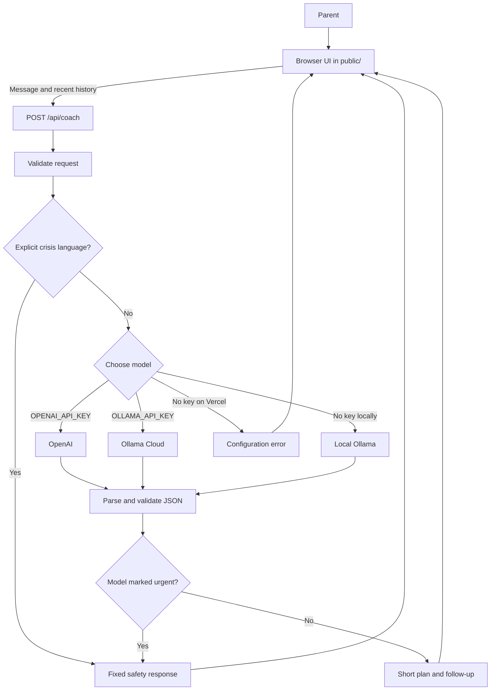

# Alpha Kids Parent Coach

A small chat-first parenting coach for concerns written in English, Urdu, or Roman Urdu. It returns a brief plan with a follow-up question, while directing crisis, abuse, and self-harm concerns to immediate human help.

**Live app:** [heemankv-aplha-kids.vercel.app](https://heemankv-aplha-kids.vercel.app/) · **Main site:** [alpha.kids](https://www.alpha.kids/)

The app uses a static web UI, a Node.js API, and an LLM. There is no login, database, or frontend framework. The mobile layout opens a dedicated full-screen chat; the desktop layout shows the introduction and chat together.

## System diagram



The browser keeps the conversation in memory and sends at most the last eight history entries with each new message. The server checks for explicit crisis language before calling a model. A model response marked urgent is also replaced with the fixed safety response.

## Run locally

Use **Node.js 20.6 or newer**. No `npm install` is needed because the app has no package dependencies.

```bash
cp .env.example .env
npm start
```

Open [http://localhost:3000](http://localhost:3000). Choose one model setup:

| Setup | What to do |
| --- | --- |
| Local Ollama, no API key | Install [Ollama](https://ollama.com/download), run `ollama pull gemma3:4b`, and start Ollama if it is not already running. Leave both API keys empty in `.env`. |
| Ollama Cloud | Set `OLLAMA_API_KEY` in `.env`. The default model is `gemma4:31b`; change `OLLAMA_CLOUD_MODEL` if needed. |
| OpenAI | Set `OPENAI_API_KEY` in `.env`. The default model is `gpt-4.1-mini`; change `OPENAI_MODEL` if needed. |

If both API keys are present, OpenAI takes priority. The local Ollama endpoint is `http://127.0.0.1:11434`; `OLLAMA_MODEL` changes its model name. `PORT` changes the local web server port.

## Deploy on Vercel

The GitHub `main` branch is connected to the Vercel project and deploys automatically. Vercel serves `public/` as the website and runs `api/coach.js` as the API function.

Set **one** of `OLLAMA_API_KEY` or `OPENAI_API_KEY` in the project's Vercel environment variables. You may also set the matching model variable. A Vercel deployment without either key returns a configuration error for ordinary coaching requests; it cannot reach Ollama running on a laptop. Explicit crisis responses still work because they do not call a model.

Keep keys in `.env` locally or in Vercel's server-side environment settings. Never put them in `public/`, a browser script, a commit, or an issue. `.env*` files are ignored by Git, except the key-free `.env.example` template.

## Safety and data

- The system prompt asks for short, practical steps and a check-in in the parent's language. It prohibits diagnosis, treatment, and medical or legal instructions.
- Explicit emergency, abuse, violence, and self-harm terms trigger a fixed safety response before inference. This is a safeguard, not a complete crisis detection system.
- There is no database. Reloading the page clears the conversation. Messages are sent to the selected inference provider for ordinary coaching, so avoid names and other identifying details.

## Try the flow

The welcome screen includes an everyday screen-time example and a crisis example. You can also enter:

```text
My child gets upset when it's time to stop screen time.
```

```text
My child says she wants to die.
```

The second example should return the fixed safety response, not an ordinary parenting plan.

## Files and checks

| Path | Purpose |
| --- | --- |
| `public/` | Responsive chat UI and static assets |
| `local-server.js` | Local HTTP server, request validation, safety routing, and model calls |
| `api/coach.js` | Vercel API function using the same response logic |
| `test/server.test.js` | API, crisis routing, and Ollama Cloud checks |
| `.env.example` | Key-free local configuration template |

Run `npm test` to check the server and safety paths without calling a live model.
